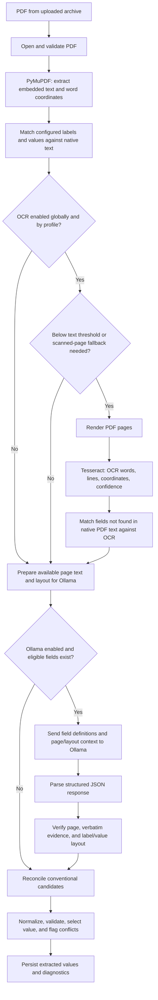

# OCR and Ollama Extraction Architecture

This document describes how DocuExtract combines embedded PDF text, Tesseract
OCR, conventional field matching, and Ollama-assisted extraction for each PDF.

## At a glance

## Processing stages

### 1. PDF loading and native text

For each PDF, `process_pdf` opens the document with PyMuPDF. Encrypted,
corrupted, or oversized PDFs are rejected. The backend extracts:

- Embedded page text.
- Individual words and their page-relative bounding boxes.
- Page dimensions and page numbers.

Native PDF text is the first source used for configured content-field matching.
The matcher groups words into rows and columns, locates configured labels and
aliases, then associates a nearby value while respecting row, column, and
neighboring-label boundaries. Filename rules are also evaluated during later
reconciliation.

### 2. Page-aware OCR fallback

OCR runs only when both the application-level `OCR_ENABLED` setting and the
profile's **Enable Tesseract OCR Fallback** setting allow it. Sparse-text pages
below `minTextLengthThreshold` are selected independently. With
`autoDetectScanned` enabled, pages with embedded images covering at least 20%
of the page or pages containing an unresolved configured label are also
selected. If fields remain missing and no suspect page is found, the backend
conservatively falls back to OCRing every page.

Standard rendering uses a 2x scale; high quality uses up to 3x, subject to a
per-page pixel limit. Tesseract returns recognized words and lines. Word
bounding boxes are converted back to PDF page coordinates and retained with
OCR confidence. Processing metrics record which page numbers were selected.

OCR uses the same label/layout matching approach as native text. When OCR has
run, the backend retains and compares both native and OCR candidates for each
configured content field, including disagreements.

### 3. Building Ollama's document context

Ollama is called only if AI is enabled and there are eligible configured
content fields:

- **Cross-check every configured field** (`strategy: review`) includes every
  content-enabled field in the AI request.
- **Fill missing fields only** (`strategy: fallback`) includes a field only
  when native text, OCR, and filename rules did not produce a value.

The context builder combines the available native-text and OCR sources by page.
For each source it provides:

- Verbatim recognized text, preserving page boundaries and row order.
- Approximate row and column positions derived from word coordinates.
- Source labels identifying native PDF text versus OCR text.

If both native and OCR text exist for a page, both are provided to the model.
OCR is therefore an additional recognized-text source, not a transformation
performed by Ollama. Ollama does not perform OCR on the PDF image.

The prompt asks the model to associate labels and values using page, row, and
column layout; preserve values as recognized; and avoid inferring or correcting
text. Document contents are treated as untrusted input. The request asks
Ollama for a JSON object with a value, page number, and verbatim evidence for
each requested field.

### 4. Validating Ollama candidates

The model's response is not accepted as-is. The backend checks that:

1. The response is valid JSON with the expected object structure.
2. The cited page exists and the candidate value is represented in recognized
   text.
3. The candidate's label/value relationship is consistent with layout and
   does not cross a configured neighboring label or unrelated column.
4. The label and value occur together in the same recognized source (native PDF
   text or OCR). A label found in native text cannot ground a value found only
   in OCR, or vice versa.
5. Evidence is grounded in that source. Layout metadata is not accepted as
   evidence; when needed, evidence is rebuilt from the cited source's text.

Candidates that are blank, unsupported, malformed, from another page, split
between sources, or inconsistent with available layout are discarded. When
usable row/column layout is unavailable, the backend abstains rather than
accepting a page-wide token match. These checks do not guarantee that OCR
recognized every character correctly.

### 5. Reconciliation, validation, and review

Native and OCR candidates are scored using matcher confidence (label
similarity, word confidence, and spatial association) plus a bonus when the
normalized value passes configured validation. If matcher confidence is
unavailable, the scorer uses a neutral input of 0.5. Scores are heuristics, not
calibrated probabilities. Identical normalized candidates agree; when
different values have scores within 0.03, extraction abstains and flags the
field as ambiguous. Otherwise, the higher-scoring candidate is selected.

Filename priorities remain in force: `filename_first` chooses a filename
match; `strict_match` and `consensus` abstain when the filename differs from
any available document-text candidate; the default `pdf_first` uses the
strongest native/OCR candidate and falls back to filename extraction. A
grounded Ollama value is selected only when no conventional value was selected.
If AI and conventional extraction disagree, the conventional value remains
selected and the disagreement is marked for review. AI-only values are also
marked for review.

`review` sends all configured content fields to Ollama; `fallback` sends only
fields missing native, OCR, and filename values. The optional `selective`
strategy sends missing, invalid, ambiguous, conflicting, or low-scoring fields.
Its 0.9 cutoff is heuristic and has not been calibrated against a representative
labeled corpus.

Diagnostics retain native, OCR, filename, and AI candidate values;
source-specific evidence and page numbers; the source kind used for an AI
candidate; native/OCR evidence scores; selection rationale; validation results;
conflicts; and review status. The displayed 0–100 evidence score is not a
probability. Processing metrics include selected OCR page numbers. The
document-wide extraction method describes the source selected for at least one
final field, not every source that was consulted.

## Configuration and data path

- OCR is controlled globally by `OCR_ENABLED` (and `TESSERACT_CMD` when
  Tesseract is not on `PATH`) and per profile by `ocrSettings`.
- Ollama is configured per profile with `aiSettings`, including model, local
  base URL, context size, timeout, and extraction strategy.
- The application connects to Ollama through a loopback URL. Local models keep
  model processing on the machine. A cloud-tagged model requires the profile's
  explicit **Allow Ollama cloud models** opt-in; enabling it sends recognized
  document text, field labels, and extraction context to Ollama's cloud
  service.
- Ollama generation requests are serialized within each backend process.
  PDF/OCR workers can wait while holding their processing slot. Inference
  concurrency has not been increased because safe throughput depends on
  available CPU/GPU memory and should be benchmarked first.

## Main implementation locations

- `backend/extraction/services/document_extraction.py`
  - PDF text extraction, OCR trigger/rendering, conventional matching,
    document-context construction, and final candidate reconciliation.
- `backend/extraction/services/ollama.py`
  - Ollama model resolution, structured extraction request, and candidate
    grounding/layout validation.
- `backend/extraction/services/job_processing.py`
  - Per-document worker orchestration, diagnostics persistence, and job status.
- `src/components/profiles/ProfilesView.tsx`
  - Profile controls for OCR quality, AI strategy, and cloud-model consent.
